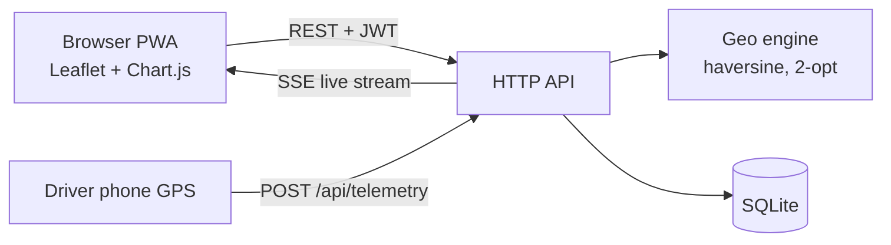
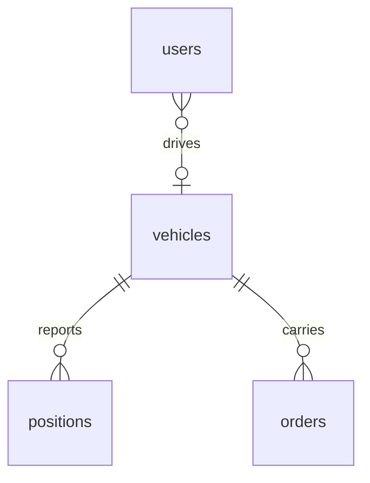

# EcoDrive Pro: Smart Fleet Logistics Platform

Role-based fleet platform for e-vans, cargo e-bikes and diesel vans around Konstanz, Germany.
Built for the OTHM Web and Mobile Applications unit (Task 2). **Zero npm dependencies**: nothing to install.

## Features
- **RBAC** with admin, manager and driver roles; drivers only see and write their own vehicle.
- **Real-time map** over Server-Sent Events; speeding alerts are pushed as toasts.
- **Route optimisation** (nearest neighbour + 2-opt) for pending deliveries, with km saved shown on the map.
- **CO₂ analytics**: emissions and savings against a diesel baseline (rough per-km estimates in `server/app.js`).
- **Driver mode**: the phone shares GPS through the Geolocation API and marks deliveries done.
- **Persistence** in SQLite (`node:sqlite`): users, vehicles, position history, orders, audit log.
- **Security**: scrypt password hashing, HS256 JWT, login rate limiting, CSP header, input validation, audit trail.
- **PWA**: manifest, service worker app shell, live-connection banner.
- **Engineering**: automated tests, GitHub Actions CI, Dockerfile.

## Architecture



## Run
```bash
npm start      # http://localhost:3000 (needs Node 22.13+)
npm test
```
Logins (password `demo123`): `admin`, `manager`, `driver1`, `driver2`. Set `JWT_SECRET` outside of demos.
Docker: `docker build -t ecodrive . && docker run -p 3000:3000 ecodrive`

## API
| Method and path | Roles |
|---|---|
| `POST /api/login` | public (5 attempts per minute) |
| `GET /api/vehicles`, `GET /api/orders` | any signed-in role (drivers filtered) |
| `POST /api/telemetry` | any role (drivers: own vehicle only) |
| `POST /api/orders`, `POST /api/routes/optimize`, `GET /api/analytics` | admin, manager |
| `POST /api/orders/:id/complete` | any role (drivers: own orders) |
| `GET /api/audit` | admin |
| `GET /api/stream?token=` | any signed-in role |

## Known limits
The SSE token travels in the query string because `EventSource` cannot set headers; production would use a short-lived stream ticket or cookies. The GPS feed is simulated in `server/index.js`.

## OTHM Task 2 mapping
| Criterion | Where |
|---|---|
| 4.1 Wireframes | `docs/wireframes/` (export from Figma) |
| 4.2 Development | `server/`, `public/`, `.github/workflows/ci.yml` |
| 4.3 Test plan | `docs/test-plan.md`, `tests/`, Lighthouse reports in `docs/lighthouse/` |
| 4.4 Evaluation | `docs/evaluation-report.md` |
